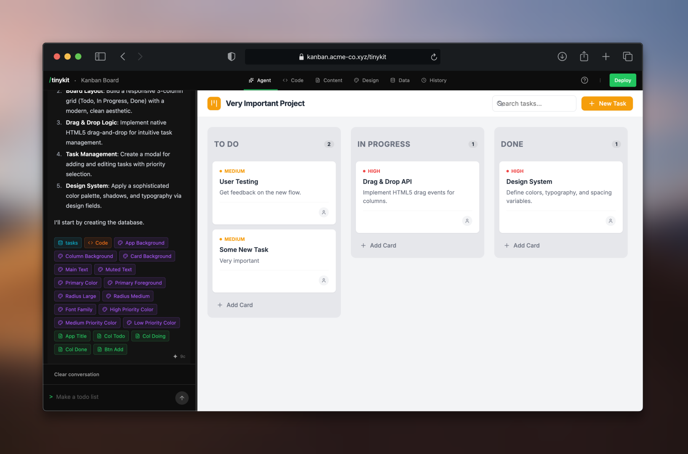

<br />
<p align="center">
  <a href="https://tinykit.studio">
    <picture>
      <source media="(prefers-color-scheme: dark)" srcset="static/logo-dark.svg">
      <source media="(prefers-color-scheme: light)" srcset="static/logo-light.svg">
      
    </picture>
  </a>
</p>
<p align="center">
    <b>The open-source agentic app builder.</b> <br />
    Think Lovable, Replit, or v0, but self-hostable and self-contained.<br>
    Build at <code>/tinykit</code>, deploy to <code>/</code>
</p>

<div align="center">

[](https://tinykit.studio/newsletter-signup) [](https://x.com/tinykit_studio) [](https://bsky.app/profile/tinykit-studio.bsky.social)

<h4 align="center">
  <a href="https://docs.tinykit.studio/quickstart" target="_blank">
    Get Started
  </a>  ·
  <a href="https://docs.tinykit.studio" target="_blank">
    Documentation
  </a>  ·
  <a href="https://tinykit.studio" target="_blank">
    Website
  </a>  ·
  <a href="https://discord.gg/NfMjt3yUtn" target="_blank">
    Discord
  </a>
</h4>



</div>

## Overview

[Tinykit](https://tinykit.studio) is an open-source platform for building and deploying web apps with AI. It manages code, database, content, and deployment under the hood, letting you focus on the details.

### Features

- **Agentic Builder**: Prompt the AI to write code, create fields and tables, and wire it all up.
- **Self-Hosted**: Your server, your data. Powered by PocketBase. Docker optional.
- **Realtime Database**: Auto-generated tables that sync in real-time.
- **Code Editor**: Direct access to your source. One Svelte file per app.
- **Content Fields**: Edit text without touching code—like a mini CMS.
- **Design System**: Update colors, fonts, shadows from a visual editor.
- **Time Travel**: Snapshots on every change. Undo anything.
- **Image Uploads**: Built-in asset storage for images and files.
- **Bring Your Own LLM**: OpenAI, Anthropic, Gemini, DeepSeek, or a compatible local/custom server.
- **Use Without AI**: Start from a template, edit code and content, and run your apps without an LLM API key.

**Run hundreds of apps on one server.** Point any domain → get a working app.

> Tinykit is early alpha. This maintenance update improves Docker setup, custom AI endpoints, domain setup, Canvas uploads, and preview/publishing reliability. See [the changelog](./CHANGELOG.md) for changes and upgrade instructions. Feedback and bug reports are welcome on [GitHub](https://github.com/tinykit-studio/tinykit/issues) and [Discord](https://discord.gg/NfMjt3yUtn).

### Star the project to give the maintainers a dopamine hit ⭐

## Getting Started

Build locally with your coding agent first. When you want a hosted instance, use Railway, Docker, or Node.js.

### Build locally with your existing agent

With Node.js 22+ and this checkout installed, add the Tinykit skill:

```sh
npm run tinykit -- skill install
```

In a new agent chat, ask **“Make a private CRM using Tinykit.”** The agent can create an app, start an app-only preview, and check its code without a hosting account. The conversation stays in your existing agent.

To try the commands yourself:

```sh
npm run tinykit -- create ./my-crm --template crm --name "My CRM"
npm run tinykit -- dev ./my-crm
```

Publishing is optional and requires an upgraded Tinykit server. First publication starts with empty hosted records; local records stay local. Later publications preserve hosted records and uploads. See the [agent-first workflow](docs/agent-first.md) for setup, diagnostics, and first publication.

### Optional browser launcher


From an installed Tinykit checkout with Node.js 22+, run:

```sh
npm run tinykit -- start
```

The local launcher opens in your browser. Sign in to your hosted Tinykit instance once, name your tracker, and choose **Create my tracker**. Tinykit creates its hosted home, prepares the local files and sample-data preview, and connects publishing automatically. To prefill your instance, use `npm run tinykit -- start --server https://your-tinykit-instance.com`.

Describe a change, choose **Codex** or **Claude Code**, and click **Open in…**. The request starts immediately using that agent's existing subscription sign-in, with no copy-paste or send step. Follow progress and the final update in the companion; **Stop** cancels the task while retaining saved edits. **Open Codex when finished** opens the saved chat only after Tinykit’s Codex process has exited, so you can continue there. Uncheck it to keep refining in the companion. **View in Codex / Claude Code** is available after the task finishes. Claude requires version 2.1.285+ and a Claude subscription login; Desktop handoff is optional and currently macOS-only. No LLM API key is needed in Tinykit. Follow-up requests use **Continue in Codex / Claude Code** and resume the same app-specific chat. Each agent remembers its own conversation across reloads and agent switches. **Recent requests in this chat** shows the last three turns; **Start new chat** starts a separate conversation with your next request and keeps your app files and data. A failed resume never silently starts a replacement chat.

Review the preview, then choose **Review & publish**. The review shows the live records being kept. Sample records stay local; publishing preserves hosted records, uploads, and settings.

Run `tinykit start` again to continue a saved app. Apps are stored in `~/Tinykit Apps` by default; an optional directory argument chooses another location. The launcher and preview remain running until you stop the local command. This first guided starter uses the single-component companion and publishes a public tracker: anyone with the link can view and edit its records. Existing Svelte project exports continue to work as before.

## Quick Deploy

Deploy on Railway and complete the setup screen. Configure AI from Settings, or start with templates and manual editing.

[](https://railway.com/deploy/tinykit?referralCode=RCPU7k&utm_medium=integration&utm_source=template&utm_campaign=generic)

Or deploy with [Docker](https://docs.tinykit.studio/docker) or a [VPS](https://docs.tinykit.studio/vps)

## Running Locally

### Docker

The simplest way to run Tinykit locally:

```bash
git clone https://github.com/tinykit-studio/tinykit.git
cd tinykit/deploy/docker
docker compose up -d --build
```

This starts Tinykit on port 3000. Visit http://localhost:3000/setup to create your account.

See [deploy/docker/README.md](./deploy/docker/README.md) for more options.

### Node.js

Use Node.js 22 or newer and npm:

```bash
# Clone and install
git clone https://github.com/tinykit-studio/tinykit.git
cd tinykit
npm install

# Start dev server (PocketBase was downloaded during installation)
npm run dev
```

Visit http://localhost:5173/setup to complete setup.

## AI providers and local models

Open `/tinykit/settings` to choose a provider and enter its exact model ID. For a local server, choose **Custom / local (OpenAI-compatible)** and set the API base URL, for example `http://localhost:1234/v1` for LM Studio. An API key is optional when your server does not require one. Select a model that supports tool calling.

Custom endpoints use Chat Completions for both the builder and history summaries. **Test** checks connectivity and authentication; it does not verify generation or tool support. [Provider setup and Docker networking](./docs/ai-providers.md) explain DeepSeek, local models, and environment configuration.

Templates, content editing, and published apps can work without AI. This release connects to model APIs; local coding-agent and subscription-based integrations are not included.

## Usage

### Local companion for coding agents

For normal Svelte projects, sign in once, export directly from your server, then use `tinykit dev` and `tinykit publish`. See the [CLI workflow](docs/cli-workflow.md) for setup, saved sign-in, local data, and source conflicts.

Export an existing app to files and edit it with your coding agent while Tinykit shows a live preview and compile errors. The companion uses an isolated local database and requires no LLM API key.

See the [local companion guide](docs/local-companion.md) for `tinykit export`, `tinykit dev`, and the first milestone's supported features.

Use `tinykit push` and `tinykit publish` to save a hosted draft and activate it while preserving live records and uploads. See the [hosted workflow guide](docs/hosted-workflow.md) for server upgrades, sign-in, and conflict handling.

### Domain-Based Routing

Each app gets its own domain. Point multiple domains to one Tinykit server:

```
calculator.myserver.com/                → Serves calculator app
calculator.myserver.com/tinykit/studio  → Edit calculator app

blog.myserver.com/                      → Serves blog app
blog.myserver.com/tinykit/studio        → Edit blog app
```

### Access Points

| URL                  | Description               |
| -------------------- | ------------------------- |
| `/`                  | Your production app       |
| `/tinykit/studio`    | Edit current domain's app |
| `/tinykit` | See all apps              |
| `/tinykit/settings`  | LLM configuration         |

### Templates

Starter templates to kickstart your apps:

| Category         | Templates                          |
| ---------------- | ---------------------------------- |
| **Productivity** | Kanban, Notes, Canvas, Timer       |
| **Finance**      | Expense tracker, Invoice generator |
| **Content**      | Bookmarks, Recipes                 |
| **Social**       | Linktree, Poll, Event RSVP         |
| **News**         | HN reader, RSS reader              |

## Get Involved

- Questions/ideas/feedback? Join us on [Discord](https://discord.gg/NfMjt3yUtn)
- Found a bug? Open an issue on [GitHub](https://github.com/tinykit-studio/tinykit/issues)

## License

[MIT](./LICENSE)

--

<p><i>Build your digital homestead.</i></p>

--

> ## Building a website? check out [Pala CMS](https://github.com/palacms/palacms)
